<p align="center"></p>

# MatRegistry

A **Docker registry of your own** with a web interface – and the registries you use elsewhere in the same place:

- **Hosted registries** (create): MatRegistry keeps the images. `docker push` and `docker pull` work as with any registry (OCI Distribution 1.1, the Docker
  Registry HTTP API v2 with its token service), with roles per person and registry, public registries for anonymous pulls, multi-platform images,
  signatures and SBOMs (the referrers API).
- **Bound registries** (bind): Docker Hub, GHCR, Quay, Harbor, a second MatRegistry … MatRegistry browses them with the stored credentials (catalog, tags,
  manifests, configs), copies images from and to them, and serves them as a **pull-through cache**: `docker pull <host>/dockerhub/nginx` fetches the image once and
  keeps answering when Docker Hub is away.
- **Copies** of an image with every platform from any registry into any other, in the background.
- **Access tokens** for `docker login` (pull only, or pull and push; with an end date), sign-in through **MatIdentity**, mail through **MatSMTP**, and keys for
  apps that pull (the capability `registry.docker`, e.g. for MatDock).

Part of the Mat family: the look is [MatDesign](https://github.com/Real-TTX/MatDesign)'s MatUi, the platform contract is MatPlatform 2.4 (contract 2).
English and German, a PWA (installable, the pages seen last stay readable offline).

<p align="center">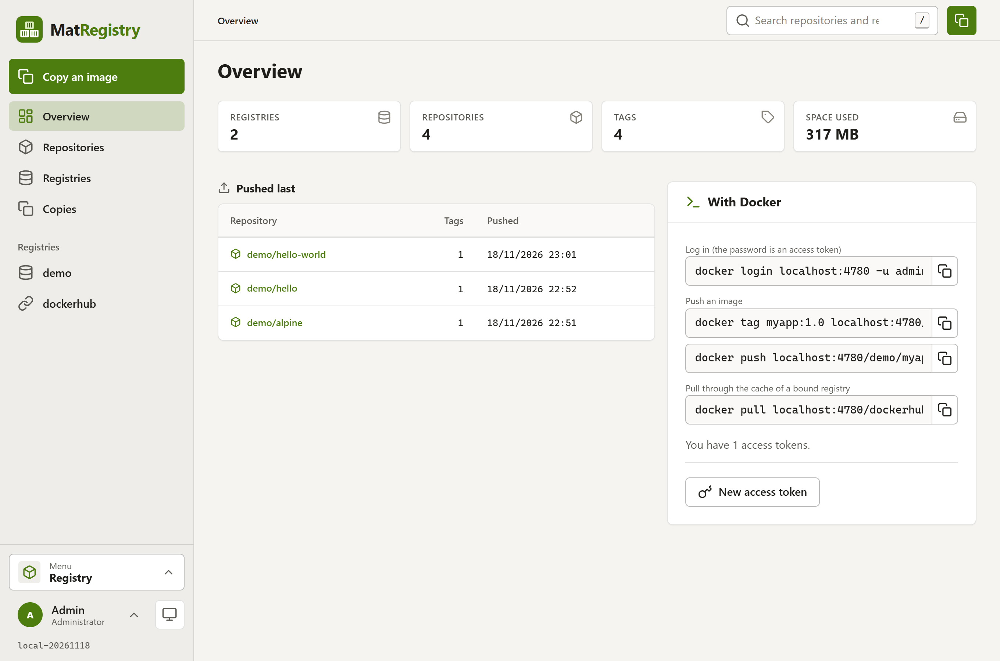</p>

## Screenshots

| | |
|---|---|
| 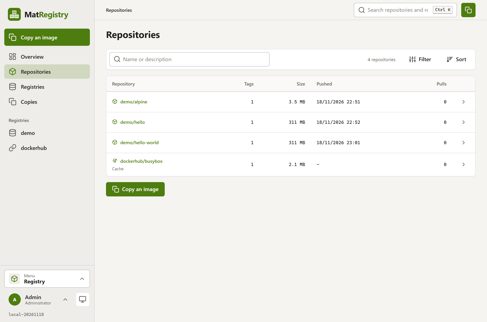 The repositories of every registry, with search, filters and sort | 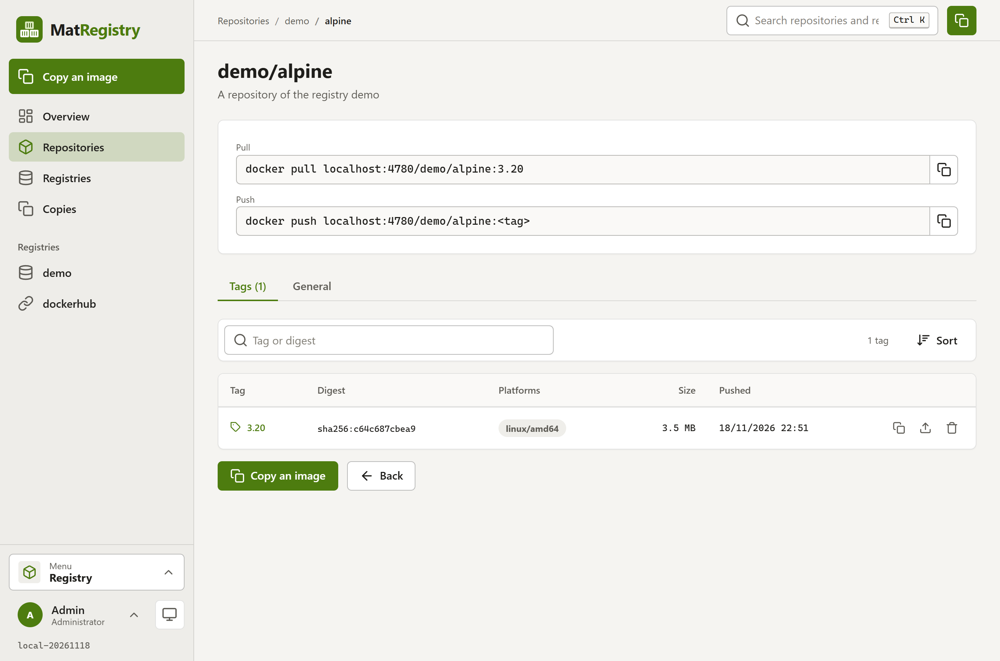 A repository: the pull command, its tags with platforms and sizes |
| 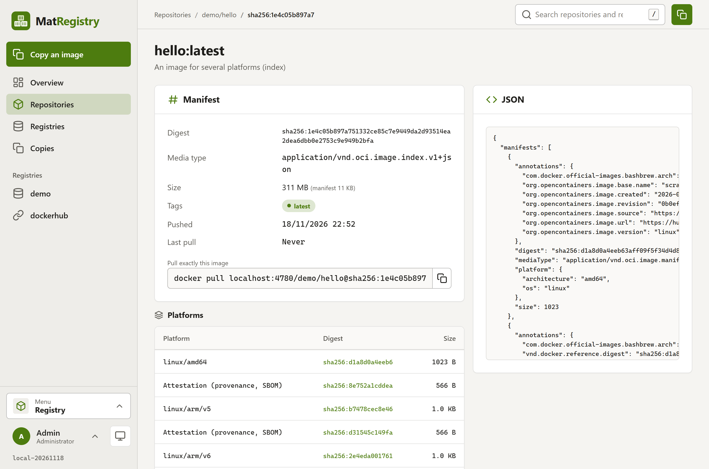 A multi-platform image: its platforms, attestations and the JSON | 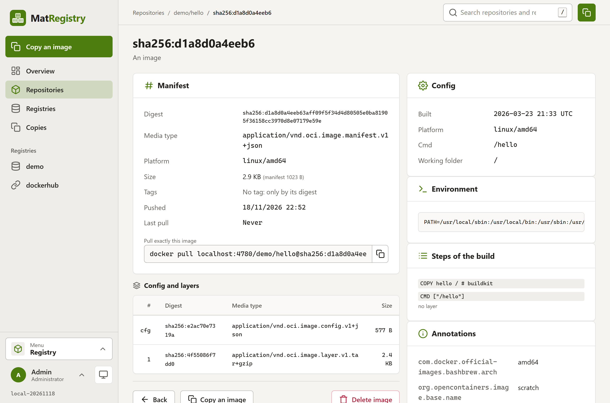 An image: config, environment, labels, layers, the steps of the build |
| 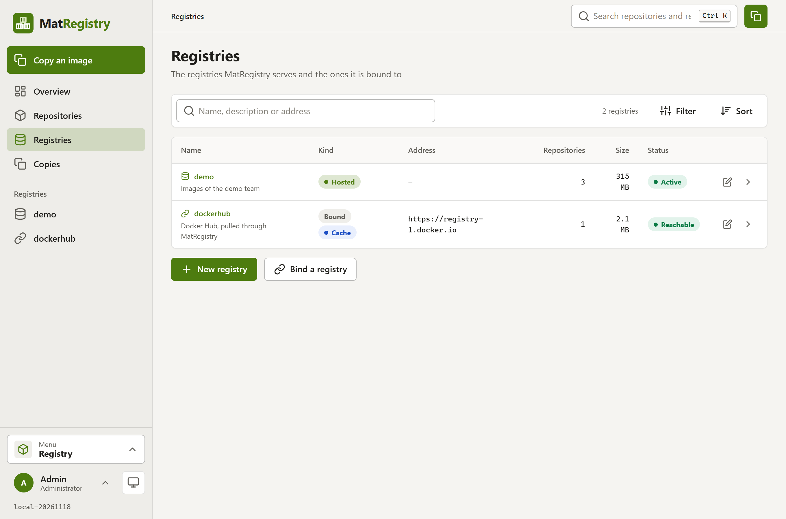 Hosted and bound registries with their state | 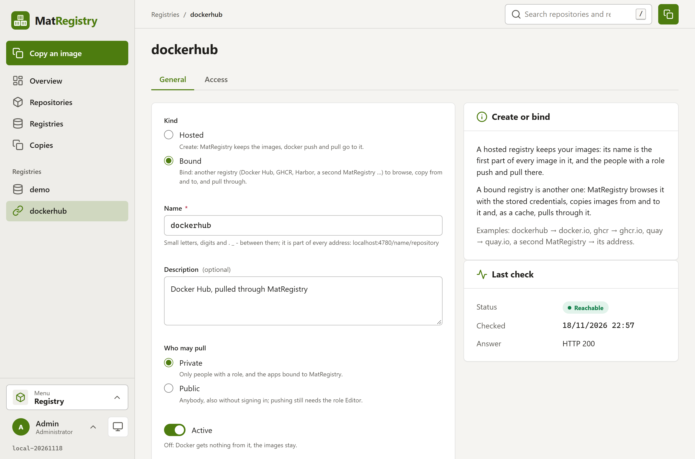 Binding Docker Hub as a cache |
| 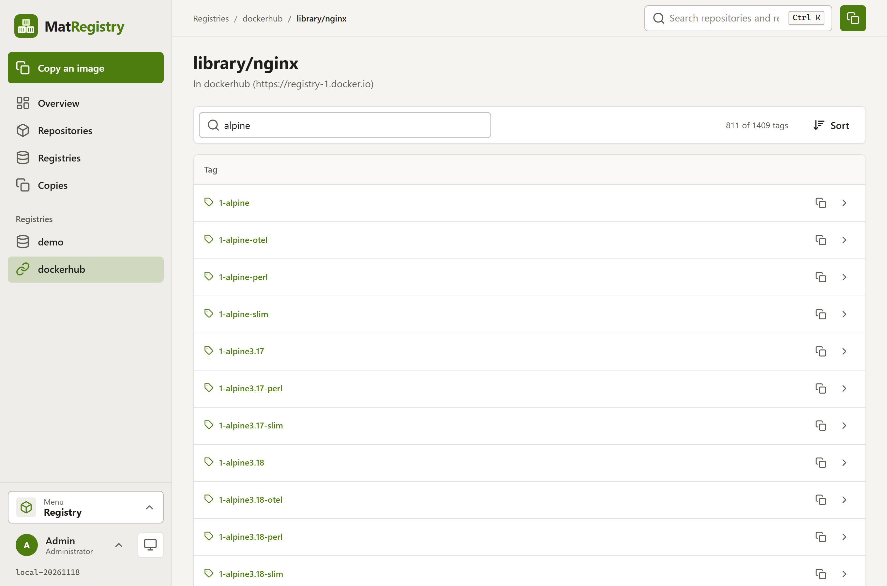 The tags of a repository of Docker Hub, searched here | 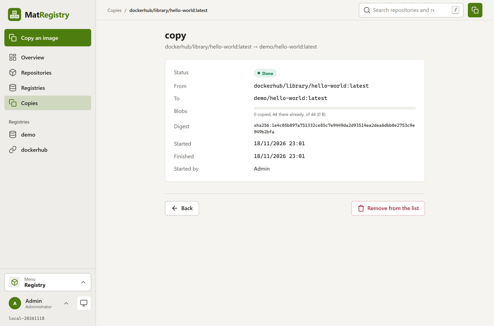 A copy from Docker Hub into a hosted registry |
| 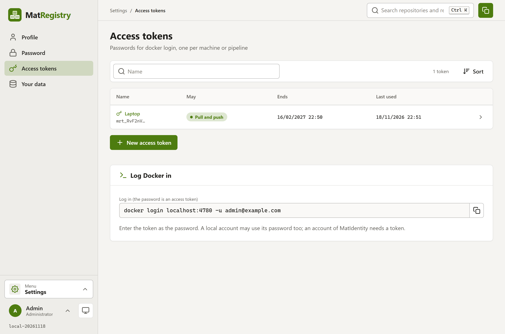 Access tokens for `docker login` | 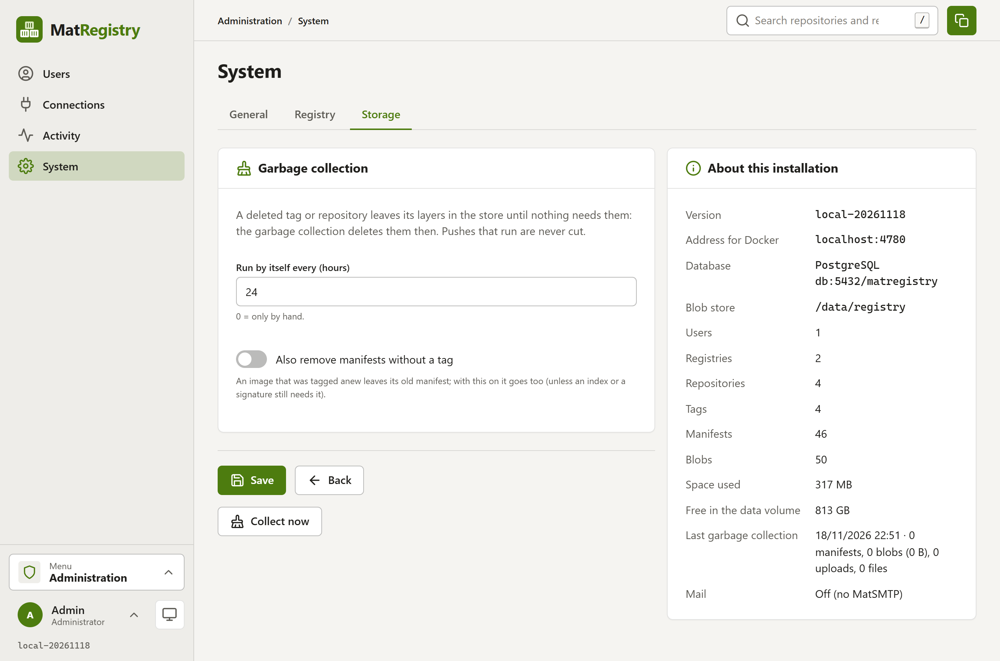 The garbage collection and the numbers of the installation |
| 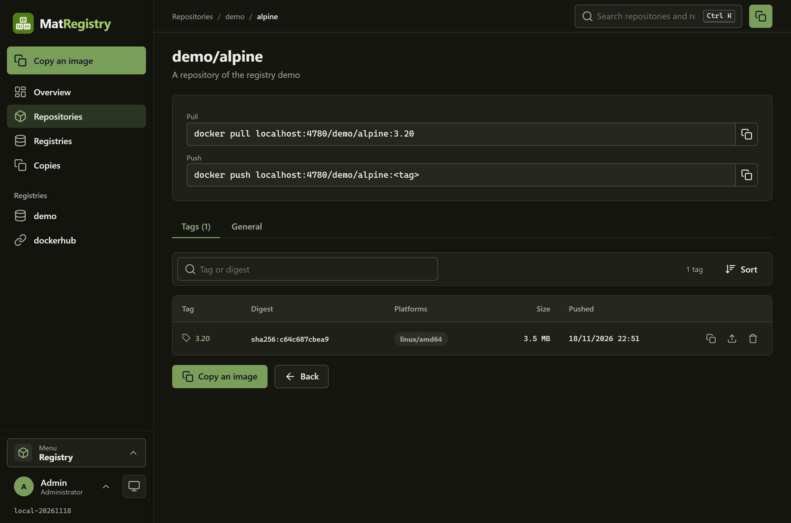 Dark mode | 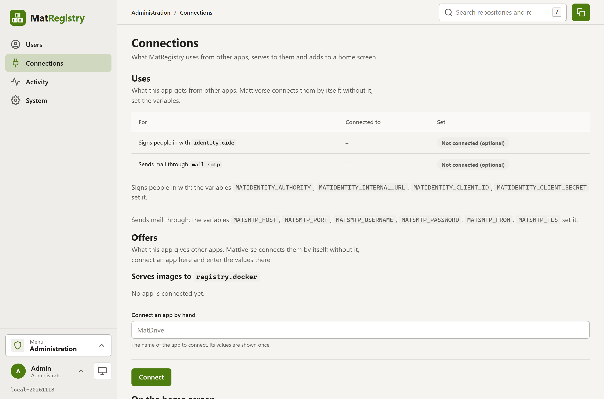 The Connections area of the platform |

<p align="center">
  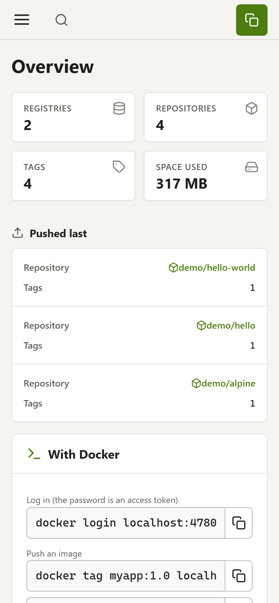
  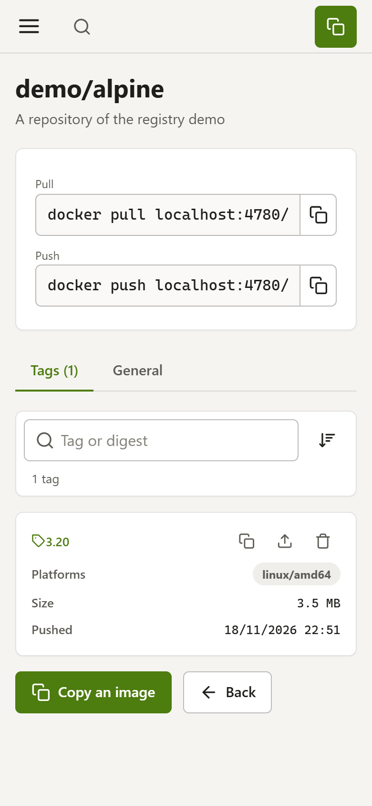
  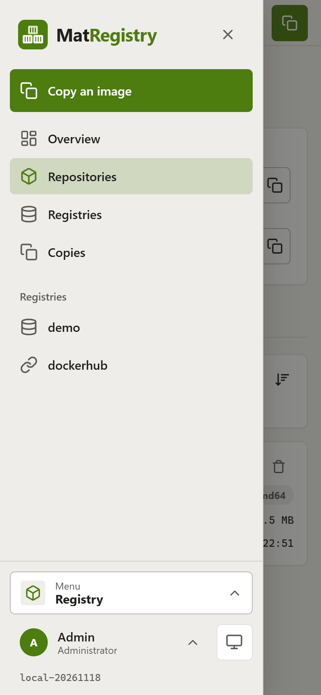
</p>

## Start

```bash
docker compose up -d          # docker-compose.yml: MatRegistry and PostgreSQL, port 4780
```

Open <http://localhost:4780>: the first account that registers is the administrator. Then:

1. **Registries → New registry** (e.g. `demo`), or **Bind a registry** (e.g. `dockerhub` → `docker.io`, with the cache on).
2. **Settings → Access tokens → New access token** (people who sign in through MatIdentity have no password here: Docker logs in with a token).
3. With Docker:

```bash
docker login localhost:4780 -u admin@example.com          # the password is the access token
docker tag myapp:1.0 localhost:4780/demo/myapp:1.0
docker push localhost:4780/demo/myapp:1.0
docker pull localhost:4780/dockerhub/nginx:alpine          # through the cache of Docker Hub
```

The first part of every image name is the **registry**, the rest the repository in it. Docker allows plain HTTP only for `localhost`: on another host put
MatRegistry behind a TLS proxy (Matcad, Caddy, Traefik …) and set its public address (Administration → System, or `MAT_PUBLIC_URL`), which is also the
address of the token service Docker is sent to.

### The registry API

| Address | What |
|---|---|
| `/v2/` | the registry API (OCI Distribution 1.1): manifests, blobs, chunked, monolithic and mounted uploads, tags, catalog, referrers, ranges |
| `/v2/token` | the token service (GET as Docker asks, POST as containerd asks): Basic credentials are an access token (`mrt_…`), the key of a bound app (`mat_…`) or the password of a local account; no credentials = an anonymous token (public registries) |

A token only names who it is; the roles are checked on every request. A pull-only token, an app bound through `registry.docker` and anonymous callers never push.
Pushing into the cache of a bound registry is refused; copy into a hosted registry instead.

## Settings

No variable is required. All of these are optional and set by Mattiverse when it installs MatRegistry; without it they go under `environment:` of `web`.

| Variable | Meaning |
|---|---|
| `MAT_PUBLIC_URL` | the public address (pull commands, the realm of the token service, links); while set, it is fixed on Administration → System |
| `MAT_API_KEY` | the key of the platform API (`/api`) for a broker |
| `MAT_FRAME_ANCESTORS` | the origins that may show MatRegistry in a frame (Mattiverse) |
| `MATIDENTITY_AUTHORITY`, `_INTERNAL_URL`, `_CLIENT_ID`, `_CLIENT_SECRET` | sign-in through MatIdentity |
| `MATSMTP_HOST`, `_PORT`, `_USERNAME`, `_PASSWORD`, `_FROM`, `_TLS` | mail through MatSMTP |

**Provides `registry.docker`** (a key capability): a binding is a key for the consumer (`MAT_REGISTRY_DOCKER_URL`, `_INTERNAL_URL`, `_KEY`); the app logs in with
`docker login <url> -u <app> -p <key>` and pulls from every registry. Made by Mattiverse, or by hand in Administration → Connections → *Connect an app by hand*.

## Development

- `./scripts/redeploy.ps1` (or `.sh`) rebuilds the image and starts `docker-compose.local.yml`: the app on <http://localhost:4780>, pgAdmin on <http://localhost:4781>,
  PostgreSQL on `localhost:4782`. `-Clean` starts with empty volumes.
- `dotnet build MatRegistry.slnx`, `dotnet test` (the API and database tests run with `MATREGISTRY_TEST_DB`, an administrator connection string of a PostgreSQL).
- Compose files: `docker-compose.yml` (release, `:latest`), `docker-compose.dev.yml` (nightly, with pgAdmin), `docker-compose.local.yml` (built here, with pgAdmin).
- Versions: release `<major>.<minor>.<build>-<date>` (branch `main`), nightly `nightly-<build>-<date>` (branch `dev`), local `local-<date>`; the GitHub action builds,
  tests and pushes `ghcr.io/real-ttx/matregistry` for both branches (amd64 and arm64).
- The logo in its levels of detail: `node scripts/logo.js` (SVGs), `./scripts/icons.ps1` (PNGs with Edge).

Made by Matthias Schmoldt.
